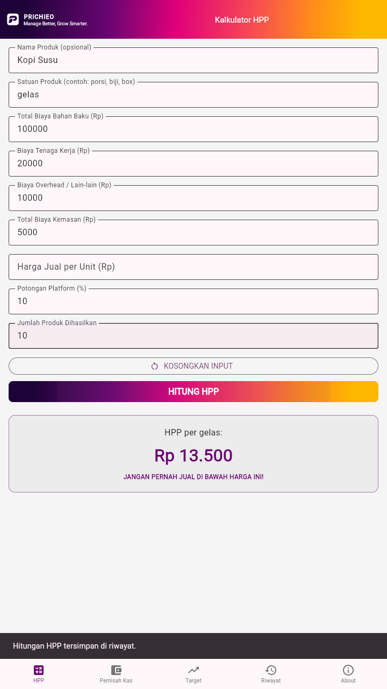
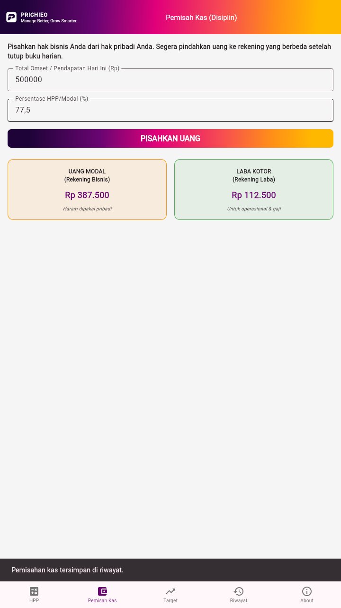
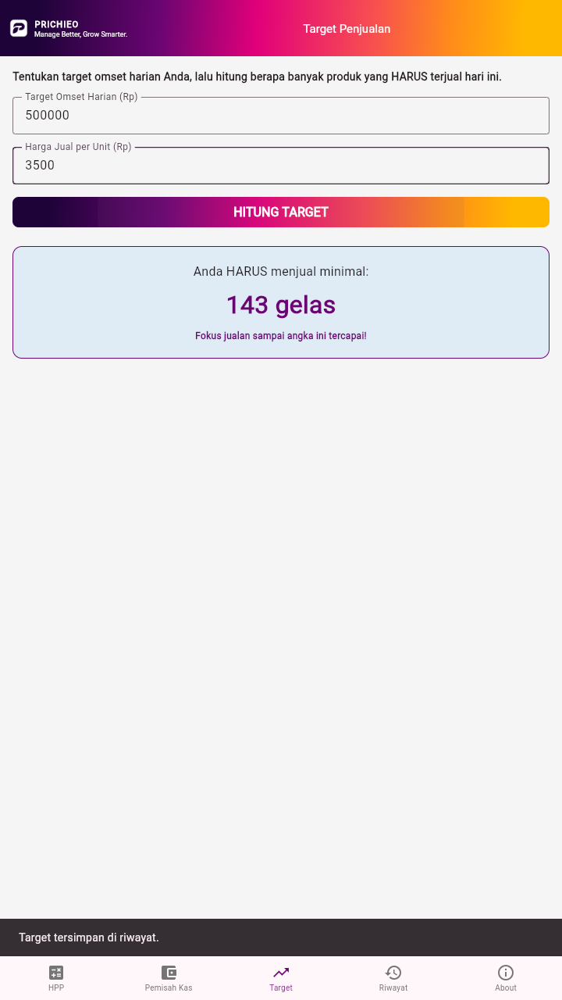
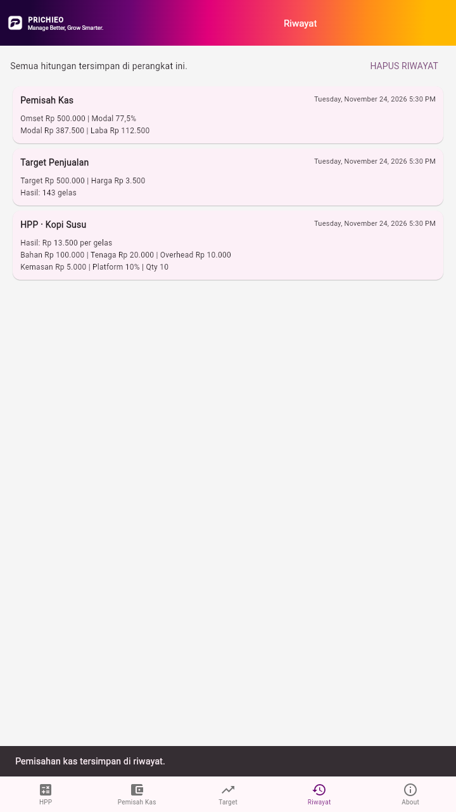
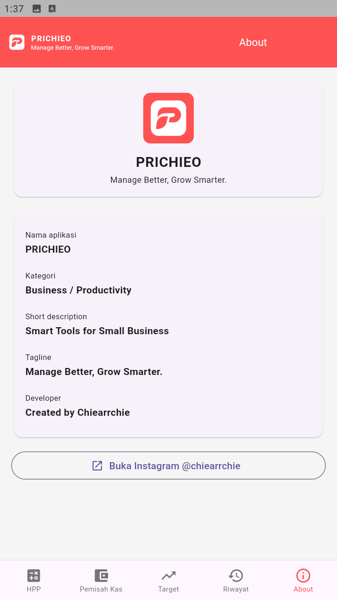

# PRICHIEO

Smart Tools for Small Business. Manage Better, Grow Smarter.

PRICHIEO adalah aplikasi Flutter untuk menghitung HPP, memisahkan uang modal dan laba, serta menentukan target penjualan. Bisa dipakai untuk produk apa pun, bukan hanya satu jenis produk. Dibuat oleh Chiearrchie.

## Unduh aplikasi

Unduh file APK dari folder `apk/prichieo-v1.1.0-release.apk`, lalu ikuti panduan di [INSTALL.md](INSTALL.md).

Link unduh langsung:

```
https://raw.githubusercontent.com/chiearrchie/prichieo-github/main/apk/prichieo-v1.1.0-release.apk
```

## Tampilan aplikasi

| HPP | Pemisah Kas |
|---|---|
|  |  |

| Target | Riwayat |
|---|---|
|  |  |

| About |
|---|
|  |

## Fitur

- Kalkulator HPP: bahan, tenaga kerja, overhead, kemasan, harga jual, potongan platform, dan jumlah produk.
- Nama produk dan satuan bisa diatur sendiri, misalnya porsi, biji, box, atau gelas.
- Persentase modal terisi otomatis dari HPP dan harga jual. Nilai awalnya 60 persen.
- Pemisah Kas membagi omset menjadi uang modal dan laba kotor.
- Target Penjualan menghitung jumlah unit yang harus terjual dari target omset.
- Riwayat tersimpan di perangkat, maksimal 50 entri, dan bisa dihapus.
- Input hitungan tersimpan otomatis di perangkat dan bisa dikosongkan lewat tombol KOSONGKAN INPUT di tab About.
- Tab About berisi identitas aplikasi dan tautan Instagram pembuat.

## Data dan privasi

Riwayat, satuan produk, dan persentase modal disimpan lokal di perangkat. Tidak ada login, tidak ada server, dan tidak ada pengiriman data hitungan ke layanan eksternal. Baca [kebijakan privasi](docs/privacy-policy.html).

## Build dari source

1. Pasang Flutter SDK 3.50.1 atau lebih baru.
2. Masuk ke folder repository ini.
3. Jalankan `flutter pub get`.
4. Jalankan `flutter run`.

Untuk menghasilkan APK rilis:

```
flutter build apk --release
```

Hasil ada di `build/app/outputs/flutter-apk/app-release.apk`.

Build rilis memerlukan `android/key.properties` dan file keystore. Keduanya sengaja tidak disertakan di repository ini. Tanpa keduanya, `flutter build apk --release` akan memakai konfigurasi debug.

## Versi

`1.1.0+2`

Catatan rilis ada di [RELEASE_NOTES.md](RELEASE_NOTES.md).
